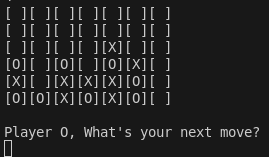
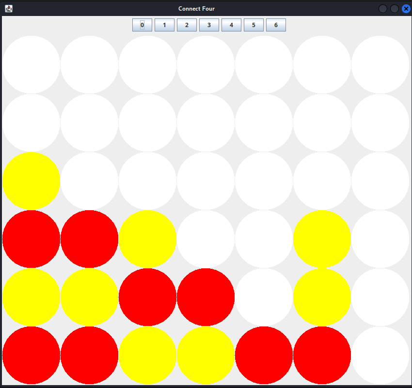

# Connect Four

A simple game of connect four implemented in java with the option to play it in the console or through the Swing UI.

## Requirements

- JDK18+

- Maven

## Usage

Run `ConnectFour.jar` to start the game.

### CLI

### UI

